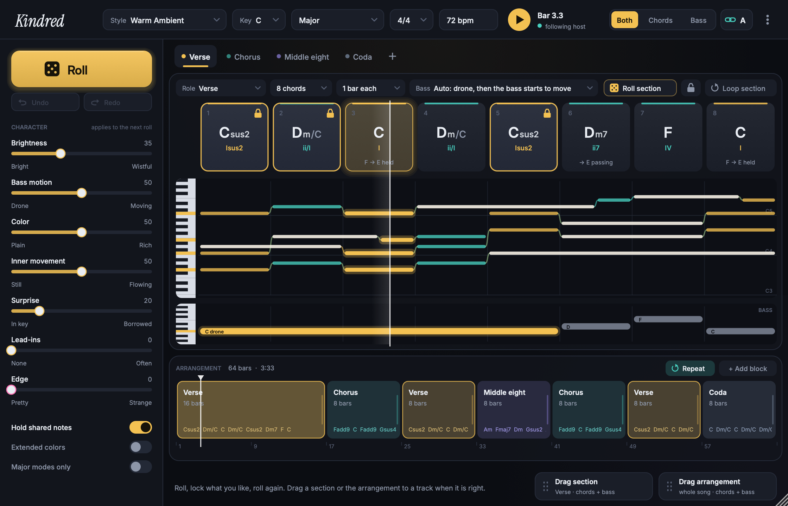
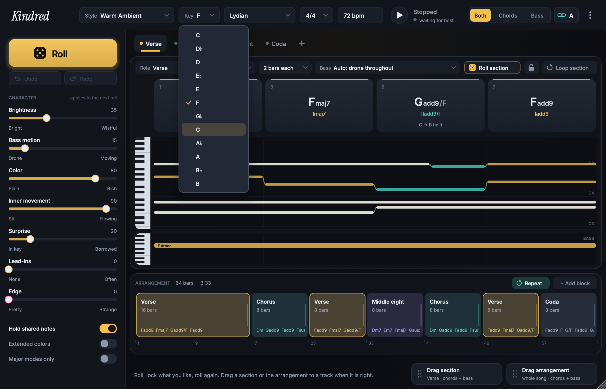
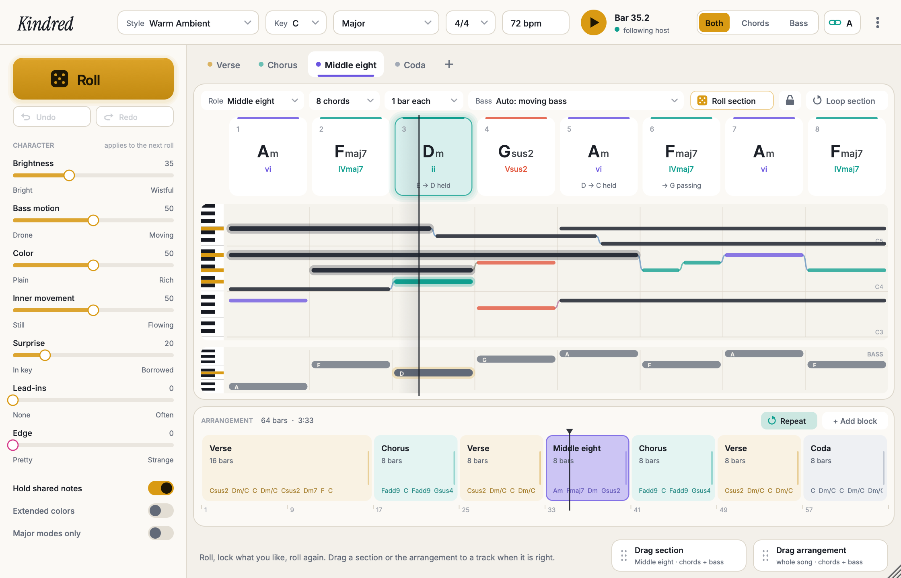
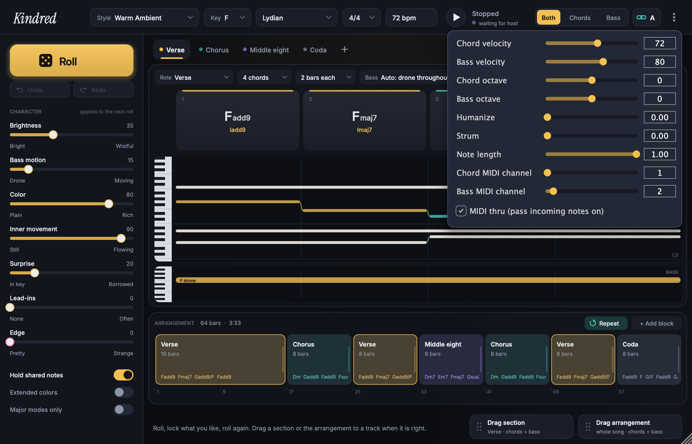
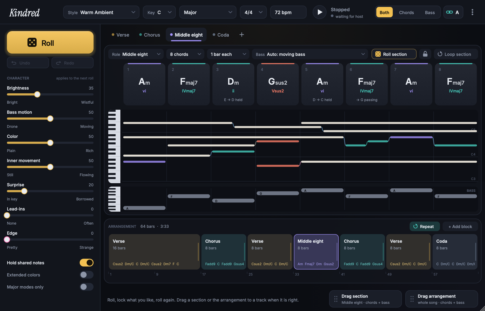

# Kindred

A chord progression and arrangement generator. It writes related chords, a bass line and voice-led voicings, arranges sections into a song, and sends the result as MIDI in time with the host.



- Audio Unit MIDI effect for Logic Pro and MainStage (macOS)
- VST3 (macOS and Windows)
- Standalone application (macOS and Windows) with MIDI output to any port

## What it does

- **Roll, lock, roll again.** Pick a key, a mode and a style, then roll. Lock the chords you like. The next roll keeps them and changes the rest.
- **Sections and an arrangement.** Each section (verse, chorus, bridge and so on) has its own progression, length and bass plan. Arrange the sections into a song on the timeline.
- **Voice leading you can see.** Each chord card shows its name, its function in the key and its voicing. Notes that two chords share are held across the change.
- **Controls, not presets.** Continuous controls set how bright, how tense and how unexpected the harmony is, how much color tones appear, and the density and humanize of the playing.
- **In time with the host.** Kindred follows the host's tempo, meter, transport and loop. Stop ends every note at once.
- **Chords and bass on two tracks.** Instances with the same Link letter share one progression. Set one to Chords and the other to Bass.
- **Drag to the timeline.** Drag a section or the whole arrangement to a track as a MIDI file.
- **Styles are data.** A style is a JSON file: modes, chord palette, bass behavior, voicing ranges and the range of each control. Two styles ship with it; you can add your own.

| | |
|---|---|
|  |  |
|  |  |

## Install

Download the build for your system from the [Actions](../../actions) page (open the latest successful run, then **Artifacts**).

- **macOS:** copy `Kindred.component` to `~/Library/Audio/Plug-Ins/Components/` and `Kindred.vst3` to `~/Library/Audio/Plug-Ins/VST3/`. `Kindred.app` goes anywhere. The bundles are not notarized: the first time, right-click the app and choose Open, or allow it in System Settings > Privacy & Security.
- **Windows:** see `INSTALL-Windows.txt` in the zip.

Then read the [user manual](docs/manual.md). Section 1 is a quick start in Logic Pro; section 2 puts chords and bass on two tracks.

## Documents

- [User manual](docs/manual.md)
- [Style file format](docs/styles.md): how to write a new style
- [Design notes](docs/design.md)
- [Engineering notes](NOTES.md): architecture, decisions, test results, what is not verified

## Status

Version 0.9.0. Tested on macOS 15 (Apple silicon) in Logic Pro. The Intel build passes its tests under Rosetta. Nobody has run it on macOS 10.13 or on Windows yet; reports are welcome in Issues.

Vendor: Neglectware. AI-authored, human-directed. License: GNU AGPL v3 (see `LICENSE`), as JUCE requires for open-source use.

## Building from source

### Requirements

- macOS: 10.13 (High Sierra) or later, Intel or Apple silicon. The bundles are universal.
- Windows: Windows 10 or later, 64-bit. See `INSTALL-Windows.txt`. Nobody has tested the Windows build on a Windows computer.

### Build

Needs CMake 3.22 or later, JUCE 8 (developed with tag 8.0.8), and node for the engine fixtures. On macOS: Xcode. On Windows: Visual Studio with the C++ workload.

JUCE is found through `-DJUCE_DIR=<path>`, then the environment variable `JUCE_DIR`, then a `JUCE` folder in or next to this folder, then `JUCE` in the `Developer` folder of your home directory.

```
git clone --depth 1 --branch 8.0.8 https://github.com/juce-framework/JUCE.git
```

#### macOS

```
tools/build.sh          # build, host test, UI test, install, auval
tools/test.sh           # engine tests: golden equivalence, rule checks, scheduler stress
```

`tools/build.sh` installs only into the user folders:

- `~/Library/Audio/Plug-Ins/Components/Kindred.component` (Audio Unit, type `aumi`, subtype `Kndr`, manufacturer `Nglw`)
- `~/Library/Audio/Plug-Ins/VST3/Kindred.vst3`
- `dist/Kindred.app` (Standalone)

If the file `tools/local-prebuild.sh` exists, both scripts run it first, and it can stop the build. It is for checks of one machine and is not in the repository.

By hand:

```
cmake -S . -B build -G Xcode -DJUCE_DIR=/path/to/JUCE
cmake --build build --config Release --target Kindred_AU Kindred_VST3 Kindred_Standalone
tools/minos.sh build/Kindred_artefacts/Release/VST3/Kindred.vst3     # minimum macOS per architecture
auval -v aumi Kndr Nglw        # from Terminal.app, not from a background shell
```

The build is universal (arm64 and x86_64) with deployment target 10.13. A call to a newer system function without an availability check stops the build (`-Werror=unguarded-availability-new`).

To remove it: delete the two bundles above and `~/Library/Application Support/Neglectware/Kindred`.

#### Windows

```
cmake -S . -B build -A x64 -DJUCE_DIR=C:\path\to\JUCE
cmake --build build --config Release --target Kindred_VST3 Kindred_Standalone
```

The results are `build\Kindred_artefacts\Release\VST3\Kindred.vst3` and `build\Kindred_artefacts\Release\Standalone\Kindred.exe`. `.github/workflows/build.yml` does the same on a build server, runs the tests, and keeps a zip as a workflow artifact.

### Version and name

`src/Product.h` holds the product name, codes, bundle id, version and build number. Add 1 to `KINDRED_BUILD` for each build you keep. To rename the product, change that file only.

### Styles

`styles/*.json` are compiled in. `node tools/make-style.js` writes both from the tables of the prototype engine (`tests/golden/prototype/`). User styles go in `~/Library/Application Support/Neglectware/Kindred/Styles` (macOS) or `%APPDATA%\Neglectware\Kindred\Styles` (Windows).

### Screenshots

`docs/screenshots/`, made by `build/KindredSnapshot_artefacts/Release/KindredSnapshot docs/screenshots`.

### Fonts

Inter and Instrument Serif, both under the SIL Open Font License (`fonts/OFL-*.txt`).
